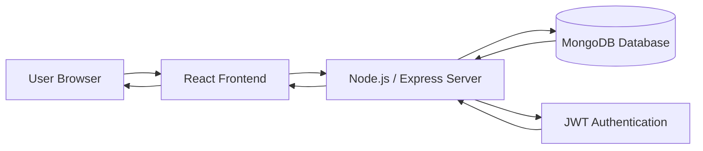

# 🏝️ Anapnoe Resort Website

<p align="center">

</p>

<p align="center">

</p>

<p align="center">

</p>

---

# 🚀 Project Overview

**Anapnoe Resort Website** is a luxury hospitality platform built using the **MERN Stack (MongoDB, Express.js, React.js, Node.js)**.

The website provides a modern and elegant interface inspired by high-end resort websites where users can explore rooms, spa services, entertainment activities, and make bookings seamlessly.

It includes a fully responsive design, interactive booking system, and an admin dashboard to manage resort content and reservations.

---

# 🧠 Project Architecture



---

# ✨ Features

- 🏨 Luxury resort style website design  
- 🎥 Full-screen video header  
- 📱 Fully responsive modern UI  
- 🛏️ Interactive room booking system  
- 🧘 Spa and wellness services pages  
- 🎭 Activities and entertainment section  
- 📸 Gallery showcase  
- 📩 Contact form with real-time validation  
- 🛠️ Admin dashboard for managing bookings and content  

---

# 📸 Application Screenshots

## 🏠 Welcome Page


---

## 🛏️ Rooms


---

## 🧘 Spa


---

## 🎭 Activities and Entertainment


---

## 📸 Gallery


---

## 📩 Contact Page


---

# 🏗️ Tech Stack

### Frontend
- React.js  
- Material UI  
- Framer Motion (Animations)  
- React Router  
- Axios  

### Backend
- Node.js  
- Express.js  
- MongoDB with Mongoose  
- JWT Authentication  
- Multer (File Uploads)  

---

# 📂 Project Structure

```
anapnoe-resort/
│
├── client
│   ├── public
│   └── src
│       ├── components
│       ├── pages
│       ├── context
│       └── utils
│
├── models
├── routes
├── middleware
├── config
└── server.js
```

---

# ⚙️ Installation & Setup

## 1️⃣ Clone the Repository

```bash
git clone https://github.com/yourusername/anapnoe-resort.git
cd anapnoe-resort
```

---

## 2️⃣ Install Dependencies

```bash
npm install

cd client
npm install
```

---

## 3️⃣ Create `.env` File

```
MONGODB_URI=your_mongodb_uri
JWT_SECRET=your_jwt_secret
PORT=5000
```

---

## 4️⃣ Run the Application

```bash
npm run dev
```

Run backend only

```bash
npm run server
```

Run frontend only

```bash
npm run client
```

---

# 🚀 Deployment

## Backend Deployment (Render / Heroku)

```bash
heroku login
heroku create your-app-name
git push heroku main
```

Set environment variables:

```
MONGODB_URI
JWT_SECRET
```

---

## Frontend Deployment

Build command:

```
cd client && npm run build
```

Publish directory:

```
client/build
```

---

# 🤝 Contributing

Contributions are welcome!

1. Fork the repository  
2. Create a feature branch  
3. Commit your changes  
4. Push to GitHub  
5. Open a Pull Request  

---

# 👨‍💻 Author

**Ranbir Singh**

💼 MERN Stack Developer  
📍 Bangalore, India  

📧 ranbirsingh9156@gmail.com  

🔗 GitHub  
https://github.com/RanbirProjects  

🔗 LinkedIn  
https://linkedin.com/in/ranbirsingh14  

---

# 📜 License

This project is licensed under the **MIT License**.

---

# 🙏 Acknowledgments

- Design inspiration from luxury resort websites  
- Material UI component library  
- Framer Motion for smooth animations  
